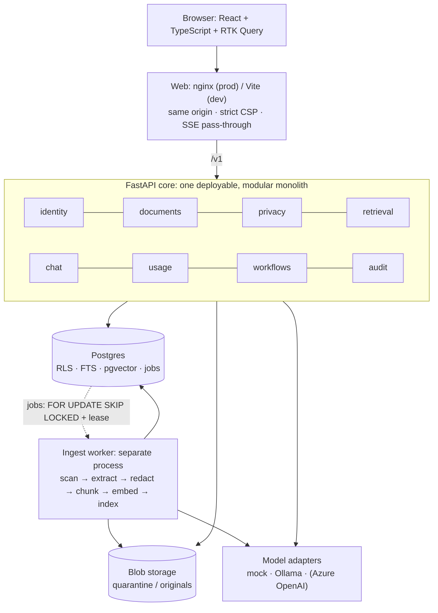
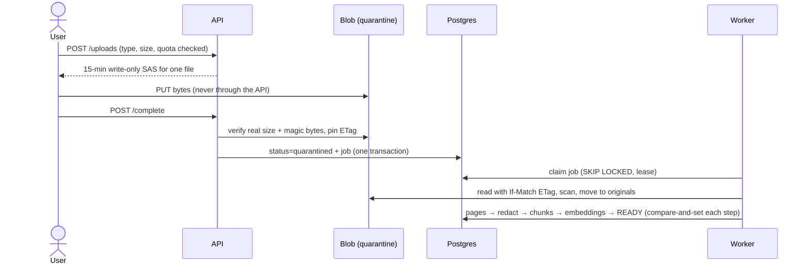

# DocuMind architecture

A secure, multi-tenant AI knowledge platform. Companies upload documents; authorized employees search them, ask questions, get answers with verified page citations, and run approved report workflows. Every claim in this document links to the **evidence** that backs it: a test, a measurement or a decision record.

## 1. System overview



UML diagrams (use case, component, class, ER, state, sequence, deployment): [uml.md](uml.md).

Each module is layered `api → service (use cases) → domain (pure rules)`. Domain code may not import FastAPI, SQLAlchemy, Pydantic or Azure SDKs.

| Decision | Why | Evidence |
|---|---|---|
| Modular monolith, not microservices | One team; no measured need for independent scaling. The worker still scales separately. | [ADR-0001](../adr/0001-modular-monolith.md); `tests/unit/test_domain.py::test_domain_has_no_framework_imports` |
| Postgres job table, not Kafka | Retries, leases and dead-lettering without a streaming platform | [ADR-0002](../adr/0002-no-kafka-first.md); `tests/integration/test_ingestion.py` (retry, dead letter, lease reclaim) |

## 2. Security model (the core of the design)

```text
request
 ├─1 signed HttpOnly SameSite=Strict session cookie   → 401
 ├─2 CSRF token bound to the session (mutations)      → 403
 ├─3 user + memberships loaded fresh, no cache        → instant revocation
 ├─4 role permission check  Principal.can(perm, tenant)
 └─5 DB transaction as documind_app (not owner, not superuser, NOBYPASSRLS)
       SET LOCAL app.user_id = <verified id>         ← the only value the app supplies
       RLS: tenant ∈ my memberships AND (workspace-visible OR creator OR admin OR granted)
```

The database enforces isolation itself, so a bug in application code, or a raw `SELECT *`, cannot return another tenant's rows.

| Guarantee | Evidence |
|---|---|
| A guessed ID from another tenant returns 404, identical to "not found" | `tests/security/test_tenant_isolation.py::test_cross_tenant_and_nonexistent_are_indistinguishable` |
| RLS holds for raw SQL, cross-tenant INSERT/UPDATE and pooled connections | `test_rls_hides_beta_rows_even_with_raw_sql`, `test_rls_with_check_blocks_cross_tenant_insert`, `test_pooled_connection_does_not_leak_identity` |
| Runtime roles are unprivileged | `test_app_role_is_not_privileged`, `test_worker_role_*` |
| Restricted documents are hidden in list, search and chat until granted; revocation is immediate | `tests/integration/test_sharing_deletion_usage.py::test_restricted_document_hidden_everywhere_until_granted` |
| Dev login can't run in production | `tests/unit/test_domain.py::test_production_rejects_dev_auth` |
| Full threat list mapped to controls | [threat-model.md](../security/threat-model.md) |

## 3. Upload and ingestion



| Guarantee | Evidence |
|---|---|
| A spoofed type or wrong size is rejected | `test_spoofed_content_type_rejected`, `test_size_mismatch_rejected_and_bytes_discarded` |
| Bytes swapped after verification are caught | `test_blob_overwritten_after_verification_is_rejected` |
| Malware fails without retry; zip bombs are rejected | `test_malware_fails_permanently_without_retry`, `test_docx_zip_bomb_rejected` |
| Deleted content is never revived by a retry | `test_delete_during_ingest_never_resurrects`, `test_deleting_document_is_never_revived` |
| Design rationale | [ADR-0005](../adr/0005-uploads-and-ingest-worker.md) |

## 4. Retrieval and cited chat (RAG)

```text
question → retrieve only READY chunks I may see (FTS + vector, filtered BEFORE ranking, RRF merge)
         → re-check each source is still ready and visible, just before the model call
         → model sees fenced, labelled, redacted evidence E1..En (untrusted data)
         → stream answer (SSE) → server keeps only the labels it issued
         → NOT_FOUND or no evidence → "couldn't find", no citations
```

| Guarantee | Evidence |
|---|---|
| The prompt never contains another tenant's text or raw PII | `tests/integration/test_rag.py::test_model_context_never_contains_other_tenant_or_raw_pii` |
| Invented citations (`[E99]`) never reach the user | `test_hallucinated_citation_never_reaches_client` |
| A refusal is never shown as "supported" | `test_model_refusal_is_never_reported_as_supported` |
| An answer without a valid citation is labelled "unverified" | `test_uncited_answer_is_marked_unverified` |
| No evidence means the model isn't called | `test_no_evidence_means_no_model_call` |
| Only redacted text is indexed; raw pages are worker-only | `test_document_indexed_with_redacted_chunks_only`, `test_app_role_cannot_read_raw_pages` |
| Design rationale | [ADR-0006](../adr/0006-secure-rag.md), [ADR-0011](../adr/0011-local-real-models.md) |

## 5. Sharing, deletion, quotas, workflows

| Capability | Mechanism | Evidence |
|---|---|---|
| Sharing | `visibility` + `sharing_grants`, enforced in RLS | [ADR-0007](../adr/0007-sharing-deletion-quotas.md); `test_revoked_grant_makes_old_citation_unavailable` |
| Deletion | Deny first (version bump), then a cleanup job removes chunks, pages and blobs and refunds quota; failures go to `needs_attention` | `test_delete_denies_immediately_then_cleans_everything`, `test_cleanup_failure_needs_attention_not_deleted` |
| Quotas | Append-only usage ledger; 429 when exhausted | `test_quota_exhaustion_returns_429`, `test_deleting_returns_storage_quota` |
| Report workflows | Cited draft → a different admin approves (code **and** a DB `CHECK`) → export; sources re-checked live | [ADR-0010](../adr/0010-evals-and-approval-workflows.md); `tests/integration/test_workflows.py` |

## 6. Identity and production platform

| Area | Choice | Evidence |
|---|---|---|
| Login | OIDC Authorization Code + PKCE; the API acts as the BFF; identity = (issuer, subject) | `tests/integration/test_oidc_flow.py` (real flow against a mock IdP); `tests/unit/test_oidc.py` (alg none, HS256 confusion, aud/iss/nonce) |
| Web | nginx serving the SPA, `/v1` proxy, SSE unbuffered, CSP/HSTS on **every** location | [ADR-0009](../adr/0009-oidc-and-azure-platform.md) (the header-inheritance bug found and fixed) |
| Azure | Container Apps (web public, api internal, worker, migrate job), Postgres Flexible Server + pgvector, keyless storage (user-delegation SAS), Key Vault, one managed identity per runtime; `tier = demo \| prod` | `infra/terraform`, `terraform validate` passes. **Not applied:** no active subscription. |
| Observability | JSON logs with secret scrubbing; OpenTelemetry traces (ids and counts only) | [ADR-0008](../adr/0008-observability-and-hardening.md); `tests/unit/test_telemetry.py`; spans verified in Jaeger |

## 7. Measured results

**Tests:** 165 passing (`.\scripts\dev.ps1 test`): unit, integration, security, OIDC flow and the golden-set gate. They run against their own database (`documind_test`), so the running app is never touched.

**End-to-end:** `.\scripts\dev.ps1 smoke` runs 19 checks against the running app through the browser path: upload, search, cited chat, refusal, cross-tenant denial, sharing, four-eyes workflow, usage, and deletion. All 19 pass on real models.

**Latency** (local laptop, mock model): [2026-11-02-local-latency.md](../benchmarks/2026-11-02-local-latency.md)

| Endpoint | p50 | p95 |
|---|---|---|
| List documents | 55.8 ms | 87.4 ms |
| Hybrid search | 52.2 ms | 129.7 ms |
| Full chat turn (mock LLM) | 149.2 ms | 183.2 ms |

**Answer quality** (16 positive, 4 negative golden questions): [ADR-0011](../adr/0011-local-real-models.md)

| Setup | hit@1 | MRR | citation | answer | correct refusal |
|---|---|---|---|---|---|
| hash + mock (CI gate) | 0.875 | 0.922 | 0.938 | 0.875 | 1.0 |
| nomic-embed-text + mock | 0.938 | 0.969 | 0.938 | 0.875 | 1.0 |
| nomic + qwen2.5:1.5b (adopted prompt) | 0.938 | 0.969 | 0.688 | 0.812 | 1.0 |

**Dependency audit:** `pip-audit` and `npm audit` report no known vulnerabilities; both run in CI.

## 8. Known limits (honest list)

- Not deployed: the Azure subscription is inactive. User-delegation SAS and Entra ID are untested against real Azure.
- Real-model answer quality is moderate with a 1.5B model. Next step: a 7–8B model, or Azure OpenAI, compared on the same golden set.
- Regex-based PII detection; soft quotas (about one request of overshoot); Postgres and storage are not yet on private networking.
- CPU-only local answers take about 15–40 s each. Production needs a GPU or a hosted model.

## 9. How to run

```powershell
.\scripts\dev.ps1 up      # app at http://localhost:5173 (deterministic mock model)
.\scripts\dev.ps1 up-ai   # same app on real local models (Ollama), re-embeds existing docs
.\scripts\dev.ps1 test    # 165 tests (separate test database)
.\scripts\dev.ps1 smoke   # 19 end-to-end checks against the running app
.\scripts\dev.ps1 eval    # golden-set quality report
```
