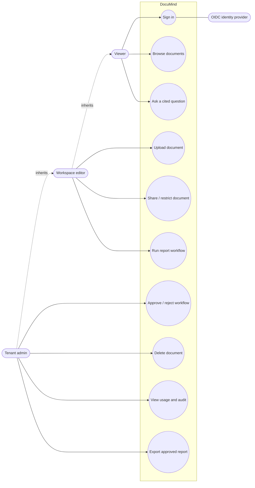
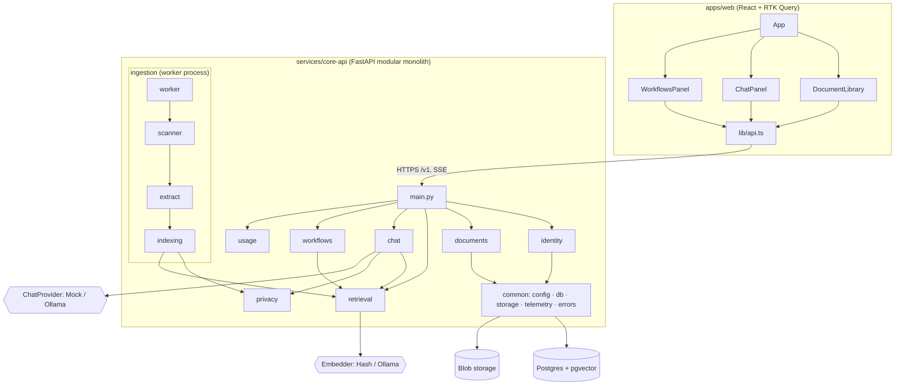
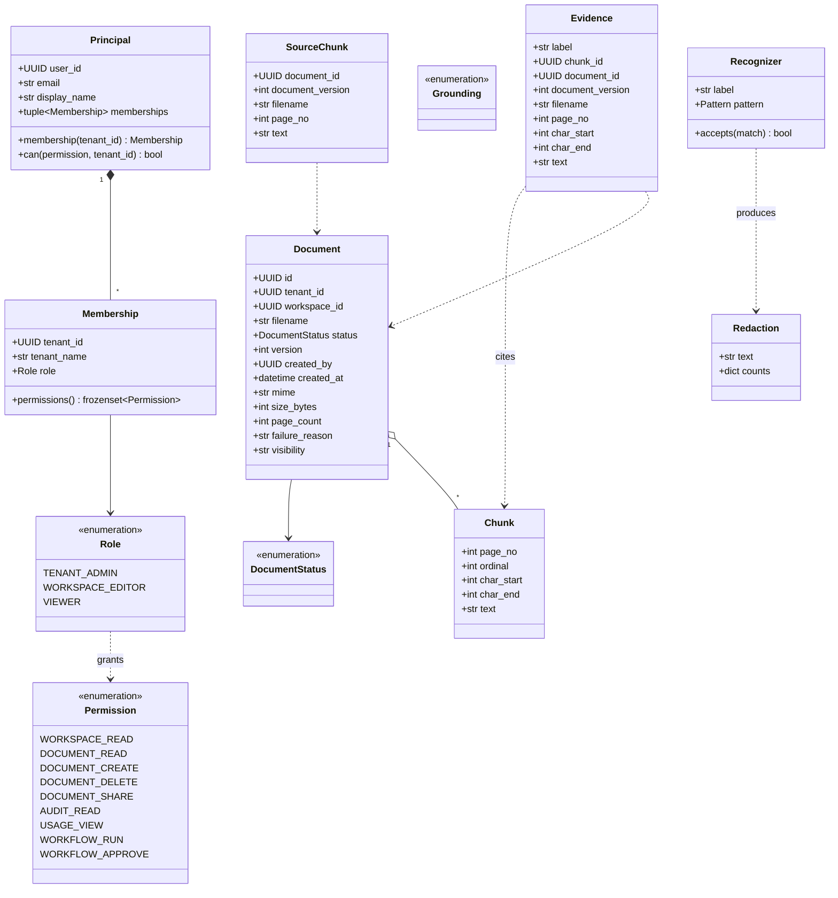
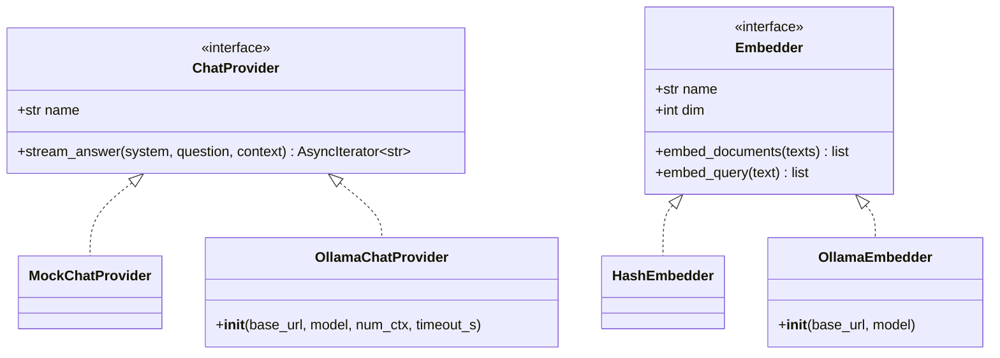
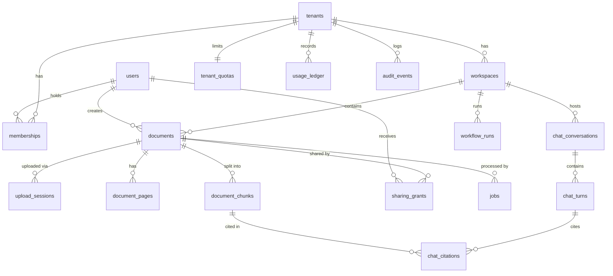
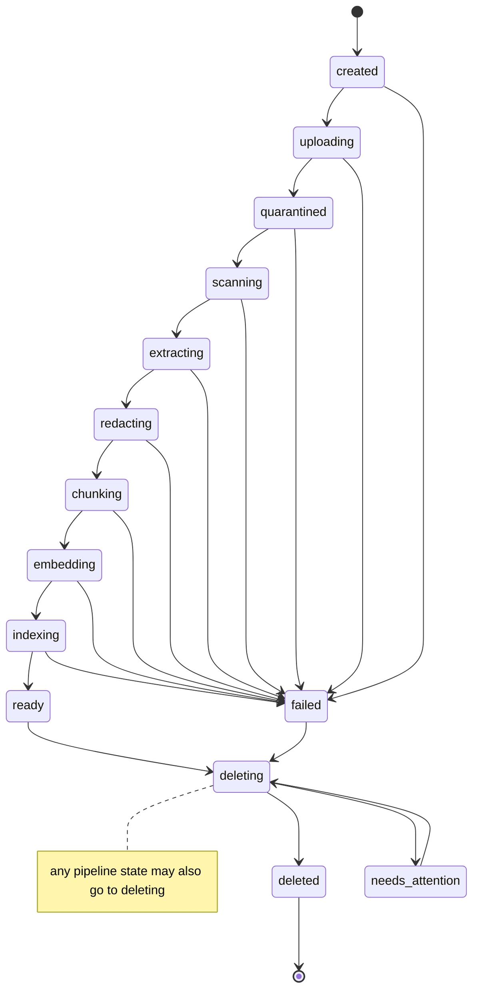
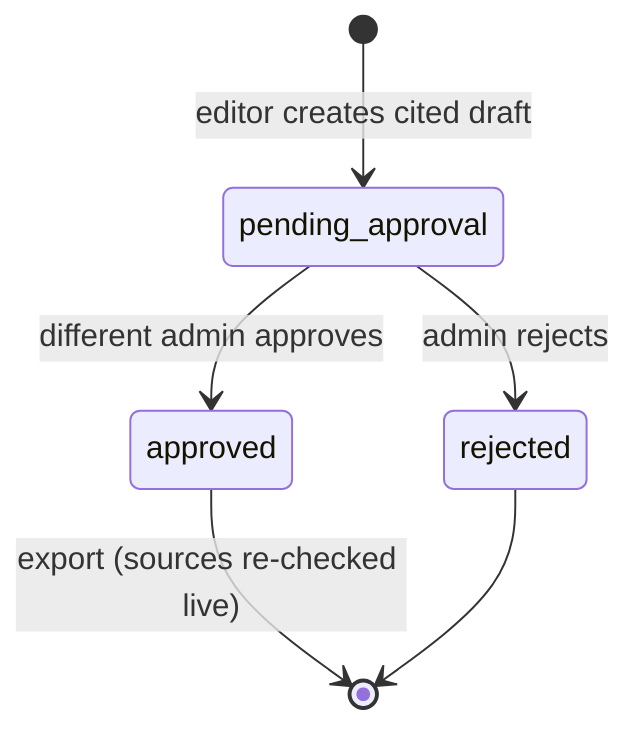
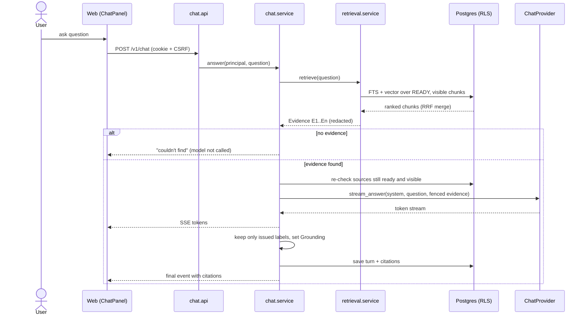
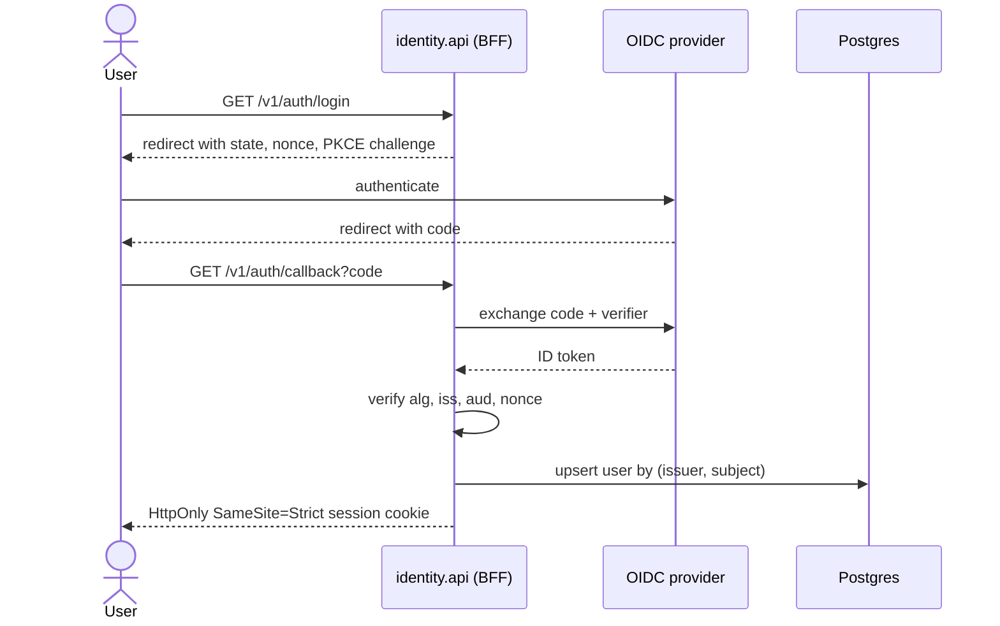
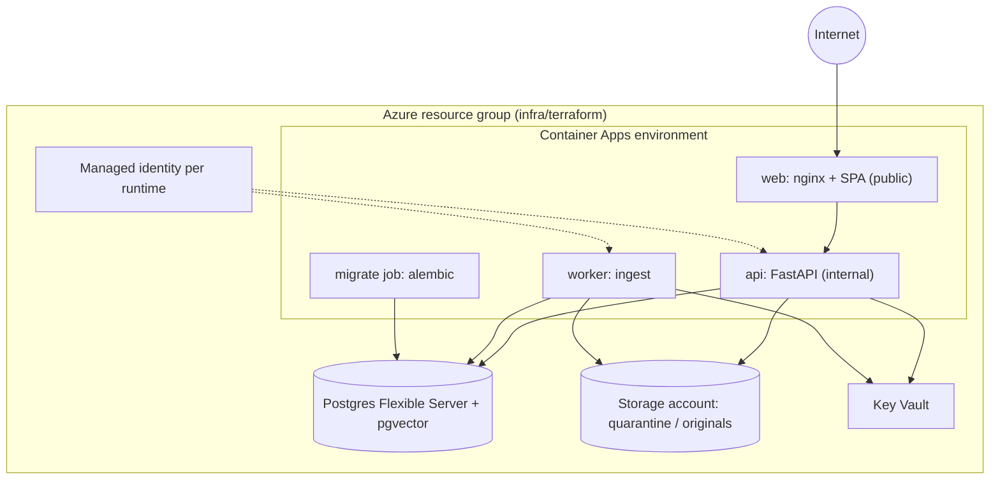

# DocuMind UML diagrams

These diagrams are written in Mermaid, which GitHub renders inline. They are derived from the code in `services/core-api/src/documind`, `apps/web/src` and `alembic/versions`. For the reasoning behind the design, see [README.md](README.md).

## 1. Use case diagram

## 2. Component diagram

## 3. Class diagram: domain model

## 4. Class diagram: model adapters (ports and adapters)

## 5. Entity relationship diagram (database)

## 6. State machine: document lifecycle

Source: `documents/domain.py` (`ALLOWED`). Only `ready` content can be opened, cited or retrieved.

## 7. State machine: workflow run

## 8. Sequence diagram: cited chat (RAG)

## 9. Sequence diagram: sign-in (OIDC + PKCE)

The upload and ingestion sequence is in [README.md §3](README.md#3-upload-and-ingestion).

## 10. Deployment diagram (Azure)

